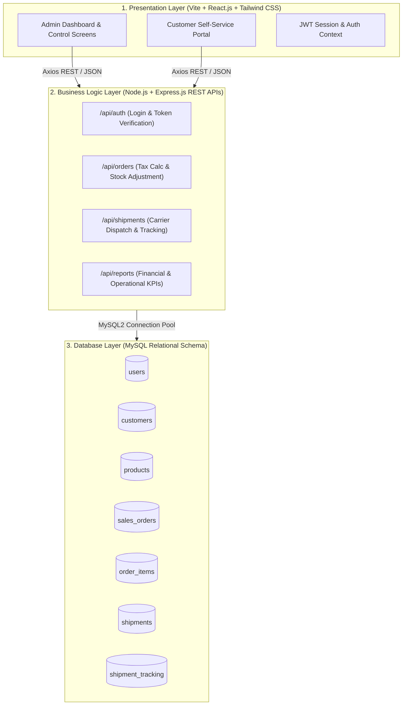

# 📦 Shipment and Sales Tracking System

> **Academic Capstone Project Submission**  
> **Institution:** SR University, Warangal — School of Computer Science & Artificial Intelligence  
> **Student:** Aarnav Padhy (Roll No: `2403A52218`)  
> **Faculty Guide:** Dr. N. Sharmila Banu, Associate Professor  
> **Degree:** Bachelor of Technology in Computer Science & Engineering  

[](https://react.dev/)
[](https://tailwindcss.com/)
[](https://nodejs.org/)
[](https://www.mysql.com/)
[](https://jwt.io/)

---

## 📄 Project Documentation

The complete 41-page academic project report is included directly in this repository:
- 📕 [**Project Report (PDF)**](docs/FINAL.pdf) — Complete academic report with all diagrams, schemas, test cases, and UI output screenshots.
- 📘 [**Project Report (DOCX)**](docs/FINAL.docx) — Editable Microsoft Word document.

---

## 🌟 Executive Summary & Overview

The **Shipment and Sales Tracking System** is an enterprise-grade full-stack web application designed to eliminate operational inefficiencies, data fragmentation, and inventory discrepancies inherent in manual order processing. 

The platform bridges the gap between sales order booking and physical logistics fulfillment by unifying customer relationship management, catalog pricing, multi-item order calculation, carrier assignment, and a six-stage real-time shipment milestone pipeline into a centralized, role-isolated architecture.

### Key Highlights
- **Role-Based Access Control (RBAC):** Distinct role boundaries isolating administrative powers from customer self-service access.
- **Automated Sales Calculations:** Exact transactional formulas computing item subtotals, an 8% statutory sales tax, grand totals, and instant atomic inventory stock decrements.
- **6-Stage Delivery Milestone Pipeline:** Real-time progression tracking across `Processing` → `Packed` → `Dispatched` → `In Transit` → `Out for Delivery` → `Delivered`.
- **Complete Relational Integrity:** Powered by MySQL with 7 normalized tables, cascading foreign keys, and complete indexing.
- **Live Search & Analytics:** Real-time KPI summaries, delivery performance percentages, revenue charts, and customer-level data isolation.

---

## 🏛️ System Architecture

The application adopts an industry-standard **Three-Tier Client-Server Architecture**:



---

## 📊 Database Schema (7 Relational Tables)

| # | Table Name | Description | Key Relationships |
|---|---|---|---|
| 1 | `users` | User credentials, password hashes (bcrypt), and roles (`admin`, `customer`) | Links to `customers.id` via nullable FK |
| 2 | `customers` | Customer company profiles, email, phone, and shipping addresses | 1-to-many with `sales_orders` |
| 3 | `products` | Product catalog, pricing, SKU codes, and stock inventory counts | 1-to-many with `order_items` |
| 4 | `sales_orders` | Header order records, subtotal, 8% tax, grand total, and status | FK to `customers.id`, 1-to-many with `order_items` |
| 5 | `order_items` | Line items for orders, quantity ordered, unit price, and item totals | Composite FKs to `sales_orders` and `products` |
| 6 | `shipments` | Carrier assignment (FedEx/DHL/UPS), unique tracking numbers, dates | FK to `sales_orders.id`, 1-to-many with tracking |
| 7 | `shipment_tracking` | Milestone checkpoint events, timestamps, locations, and descriptions | FK to `shipments.id` |

---

## 🚀 Quick Start Guide

### Prerequisites
- [Node.js](https://nodejs.org/) (v16.x or higher)
- [npm](https://www.npmjs.com/) (v8.x or higher)
- [MySQL Server](https://dev.mysql.com/downloads/mysql/) (v8.0 or MariaDB) running on `localhost:3306`

### 1. Clone the Repository
```bash
git clone https://github.com/Aarnav26-FRC/Shipment-And-Sales-Tracking-System.git
cd Shipment-And-Sales-Tracking-System
```

### 2. Backend Setup
```bash
cd backend
npm install
```
Configure environment variables in `backend/.env` (or copy `.env.example`):
```env
PORT=5000
DB_HOST=127.0.0.1
DB_PORT=3306
DB_USER=root
DB_PASSWORD=your_mysql_password
DB_NAME=shipment_sales_db
JWT_SECRET=super_secret_jwt_key_shipment_sales_2026
```

Start the backend server (automatically initializes the database, creates all 7 tables, and seeds initial demo records):
```bash
npm start
# Server starts running at http://localhost:5000
```

### 3. Frontend Setup
In a new terminal window:
```bash
cd frontend
npm install
npm run dev
# Frontend starts running at http://localhost:5173
```

---

## 🔑 Evaluator Demo Credentials

The login screen provides **one-click demo account filling** for quick academic evaluation:

| Role | Email Address | Password | Accessible Modules |
|---|---|---|---|
| **Administrator** | `admin@tracking.com` | `admin123` | Complete access: Dashboard, Customers, Products, Orders, Shipments, Tracking, Reports |
| **Customer (Acme Corp)** | `customer@acme.com` | `customer123` | Customer Portal: Personal Orders, Tracking & History |
| **Customer (TechCorp)** | `techcorp@tracking.com` | `customer123` | Customer Portal: Personal Orders, Tracking & History |

---

## 🧪 Integration Verification Tests

The repository includes an automated end-to-end integration test suite covering all critical business logic:
```bash
cd backend
node test-integration.js
```

### Test Coverage (8 / 8 Passing)
- `TC01`: Administrator authentication & JWT token generation.
- `TC02`: Customer creation & email uniqueness constraint.
- `TC03`: Product catalog entry & automatic SKU generation.
- `TC04`: Multi-item sales order calculation ($Subtotal + 8\% \text{ Tax} = Grand Total$) and automatic inventory deduction.
- `TC05`: Shipment generation with tracking number & carrier assignment.
- `TC06`: Sequential 6-stage milestone progression updates.
- `TC07`: Public unauthenticated tracking number query verification.
- `TC08`: Customer data isolation & unauthorized administrative access rejection.

---

## 👨‍💻 Author

- **Student:** Aarnav Padhy
- **Roll Number:** 2403A52218
- **Department:** Computer Science & Engineering, SR University
- **GitHub:** [@Aarnav26-FRC](https://github.com/Aarnav26-FRC)
- **Academic Guide:** Dr. N. Sharmila Banu
